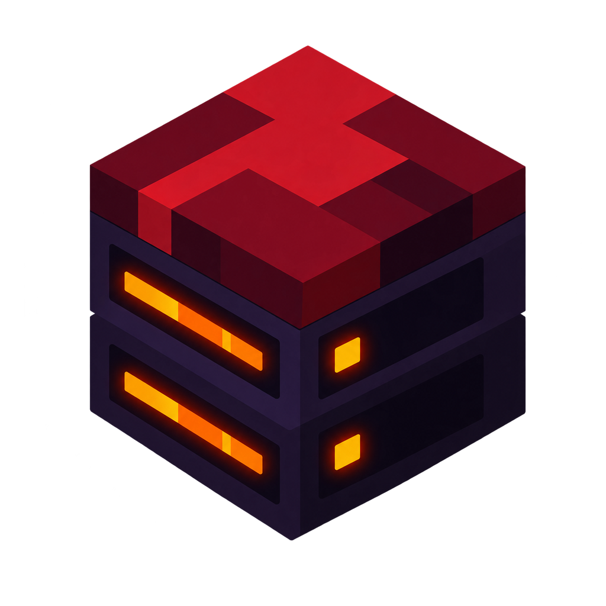
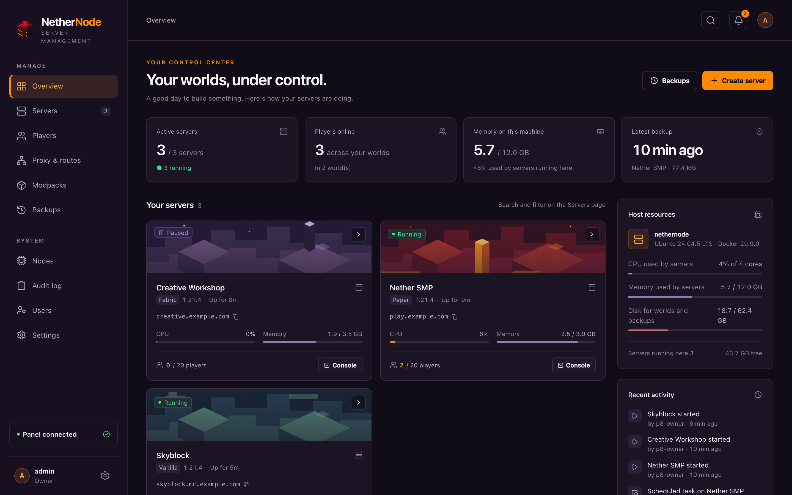
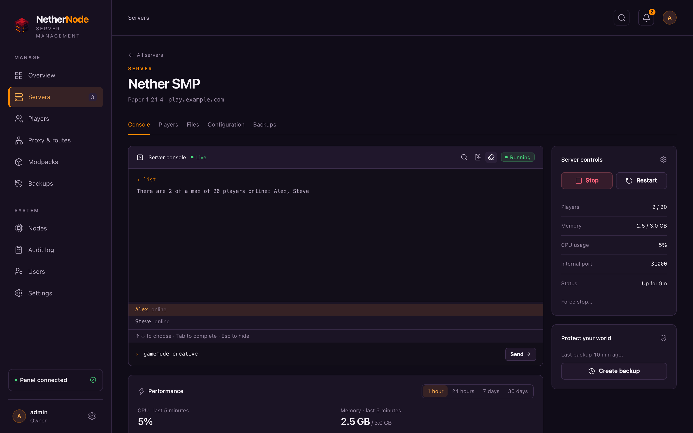
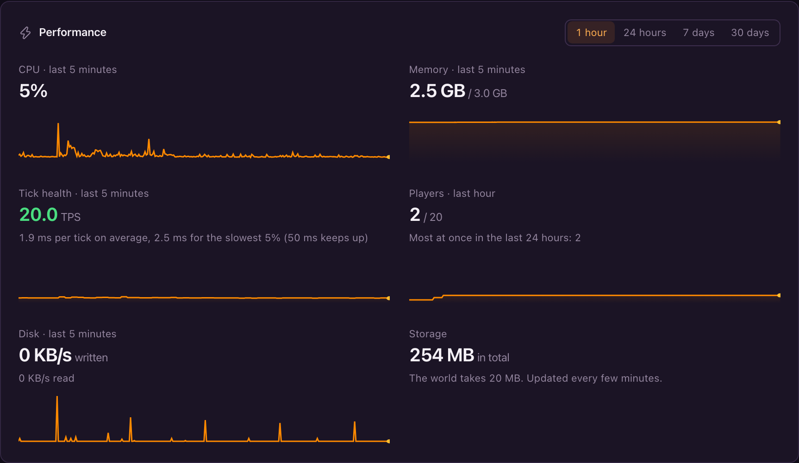
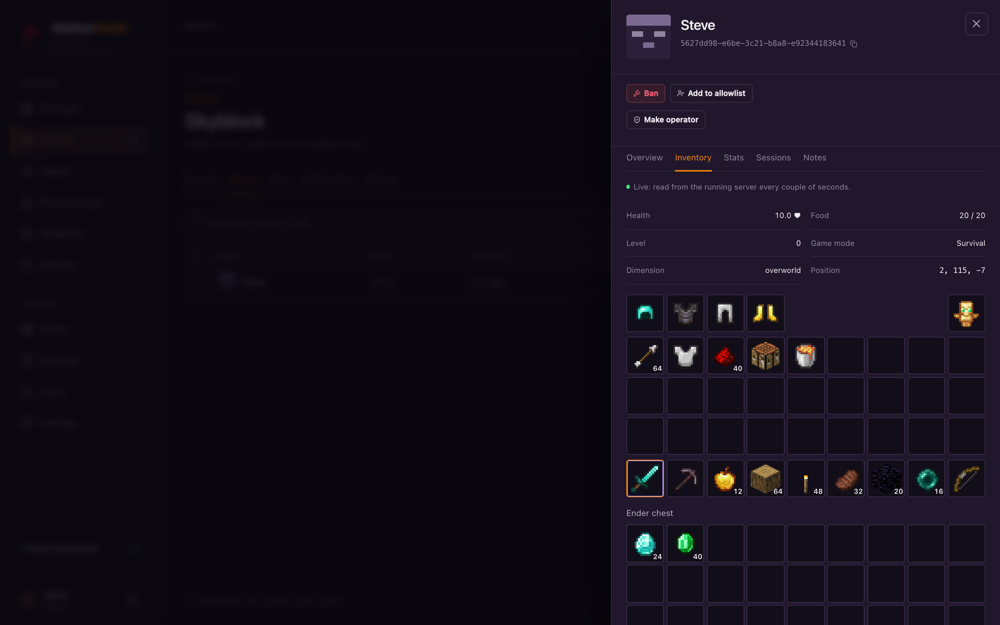
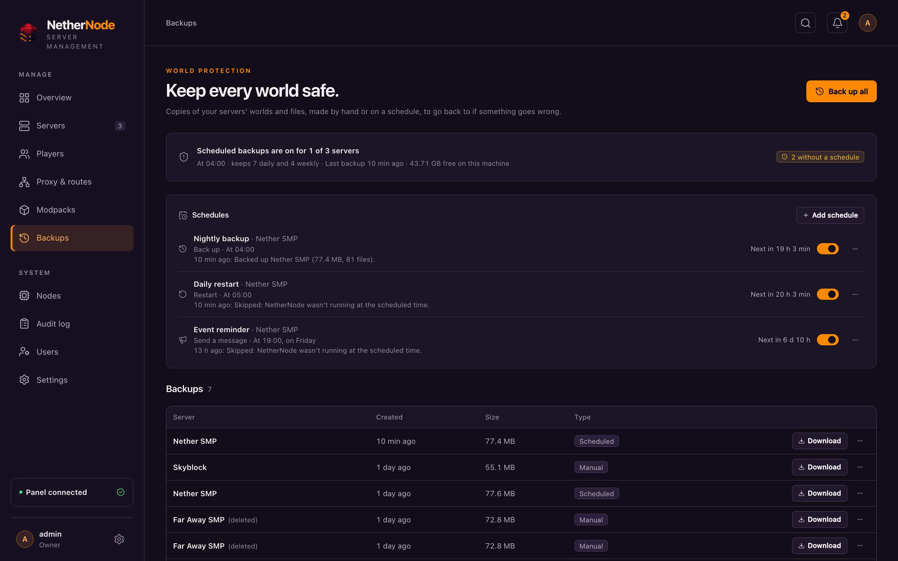
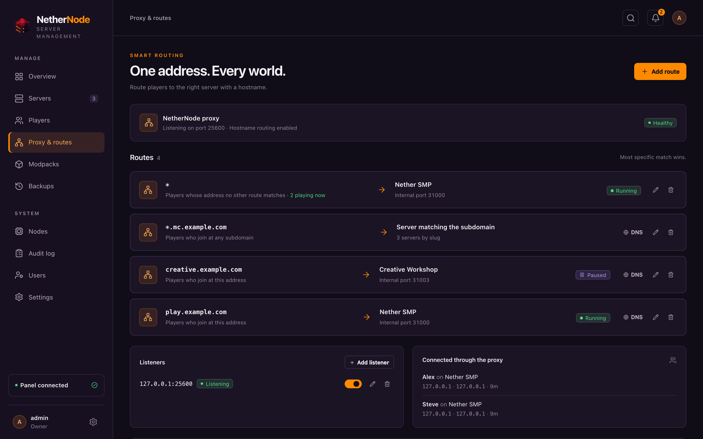
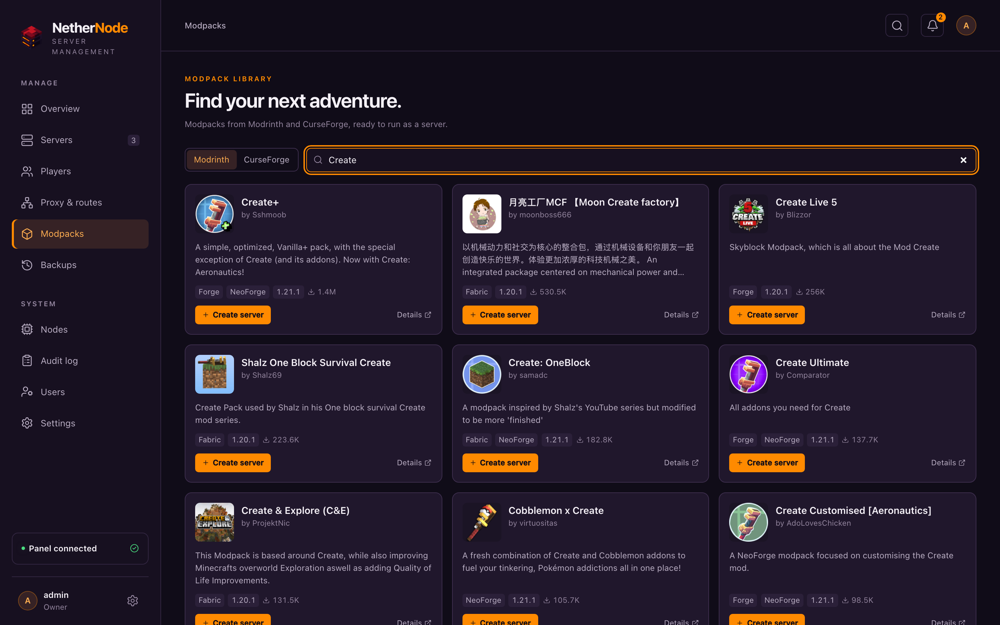
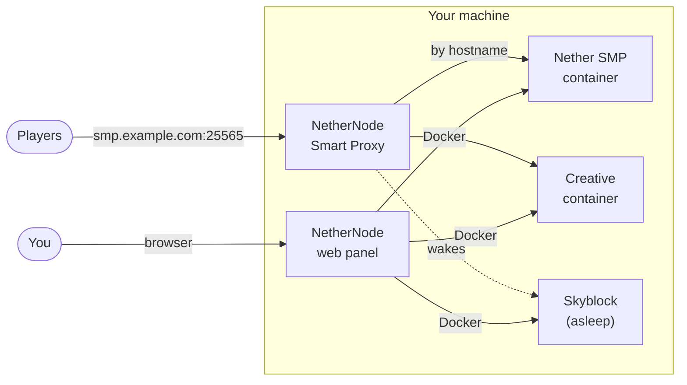

<p align="center"></p>

<h1 align="center">NetherNode</h1>

<p align="center"><strong>Your Minecraft worlds, under control.</strong><br>
A fast, self-hosted panel that runs your servers in Docker and routes every player through one port.</p>

<p align="center">
  <a href="counter/README.md"></a>
  
  <a href="LICENSE"></a>
</p>

<p align="center"></p>

## Why NetherNode

Running a few Minecraft servers at home usually means juggling ports, scripts
and a separate proxy. NetherNode is one program that does all of it from a
web panel:

- **One address, every world.** A built-in Smart Proxy listens on port 25565
  and sends each player to the right server by the hostname they type, so
  `smp.example.com` and `creative.example.com` share one IP and one port.
- **Servers that sleep.** Idle servers stop on their own. Players still see
  them in their server list ("Sleeping, join to wake"), and joining starts them.
- **Any server, any pack.** Vanilla, Paper, Fabric, Forge, NeoForge and Quilt,
  or install a Modrinth or CurseForge modpack in a few clicks.
- **Everything in the browser.** A live console that completes commands and
  player names and searches the logs of earlier runs, a file manager and
  editor, uploads of any size that resume, mod management, and
  `server.properties` as a form.
- **Players.** Operators, allowlists, bans per server or everywhere (enforced
  by the proxy before a login even reaches a server), stats, and live
  inventories drawn with the game's own item icons, modded items included.
- **See how it's running.** CPU, memory, tick health (TPS), players and disk,
  live and over the last day, week or month. Servers Minecraft has paused
  for want of players say so.
- **Backups you don't think about.** Live backups while people play, safe
  restores that keep a copy of what was there, and schedules for backups,
  restarts with in-game warnings, commands and announcements.
- **More machines.** Add other computers as nodes and run servers on them
  from the same panel. They connect out to the panel, so they need no open
  ports, and players still join through the one address. Stopped servers move
  between machines in a click.
- **Copies and templates.** Copy a server to any machine, with or without its
  world, or save its setup as a template to start new servers from.
- **Room for friends.** Roles from viewer to owner, one-time passwords,
  two-factor sign-in, an audit log, and Discord notifications.
- **Updates in a click.** The panel tells you when a new version is out and
  updates itself from Settings; the other machines follow on their own.
- **Light.** A single static binary with the panel built in; it idles at a few
  tens of megabytes of memory.

## A closer look

| Server console | Performance | Live inventories |
| :---: | :---: | :---: |
|  |  |  |

| Backups and schedules | Proxy and routes | Modpacks |
| :---: | :---: | :---: |
|  |  |  |

## How it works



Each server runs in its own container using the
[itzg/minecraft-server](https://github.com/itzg/docker-minecraft-server)
image, with its ports on `127.0.0.1` so players can only reach it through the
proxy. NetherNode keeps its settings in SQLite, encrypts stored secrets, and
talks to servers over RCON or Minecraft's management protocol.

## Get started

You need a Linux machine (x86-64 or ARM64) with Docker. Start NetherNode with
one command:

```sh
docker run -d --name nethernode --restart unless-stopped --network host \
  -v /var/run/docker.sock:/var/run/docker.sock \
  -v nethernode-data:/data \
  ghcr.io/ziggy46/nethernode:latest
```

Or with Docker Compose, using [`docker-compose.yml`](docker-compose.yml):

```sh
docker compose up -d
```

Open `http://<machine>:8080`, create the owner account, and create your first
server. To let friends join from outside your network, point a hostname at the
machine (or forward port 25565 on your router) and add a route on the
**Proxy & routes** page; it lists the DNS records each route needs.

Images are tagged `latest` and by version (`0.2.6`, `0.2`); `edge` follows
the main branch. NetherNode can also run as a plain binary from the releases
page.

> [!IMPORTANT]
> NetherNode controls Docker, which is root on the machine, so treat panel
> accounts like administrator accounts. Keep the panel off the open internet:
> reach it on your network, over a VPN, or through a reverse proxy or tunnel
> with access control in front.

## Documentation

The full guides (installing, running servers, DNS and ports, the proxy,
Cloudflare Tunnel, backups, more machines, users, notifications and updates,
configuration, the API and the security model) live in the
**NetherNode-docs** repository, with a hosted site coming.

## The install count

The badge at the top counts installs that chose to be counted. It's **off by
default**: an owner can turn it on in **Settings › Anonymous stats**. Once a
day it then sends a random ID made on that machine and the version number,
nothing else; turning it off deletes the ID. The counter is open source in
[`counter/`](counter/README.md).

## Development

You need Rust 1.96, Node 26 with pnpm, `protoc`, `just`, and Docker.

```sh
just setup     # install web dependencies
just dev       # panel with live reload (UI on :5173)
just lint      # formatting, clippy, protos, types, accessibility checks
just test      # Rust and web unit tests
just build     # release binary with the UI embedded
pnpm --dir web e2e   # browser tests against the built binary
docker build -t ghcr.io/ziggy46/nethernode:latest .   # the image, from source
```

The backend is Rust (axum, ConnectRPC, sqlx on SQLite, bollard for Docker);
the panel is React with TanStack Router and Query. API definitions are the
`.proto` files in `proto/`.

## License

[MIT](LICENSE)
